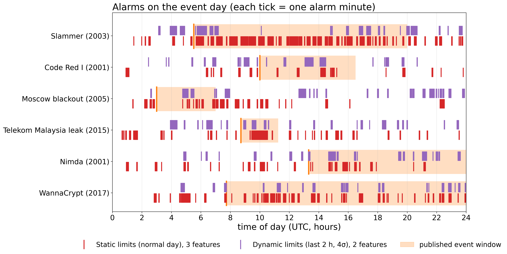
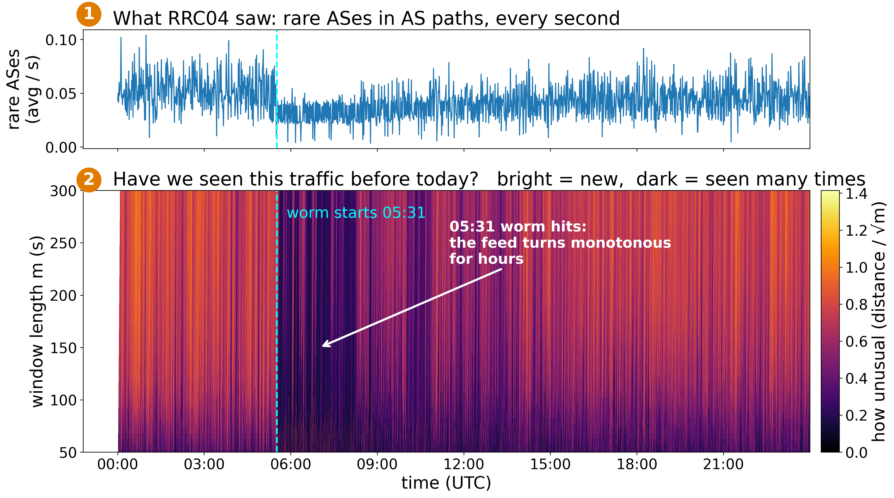

# Worms, leaks and blackouts: would your route collector have raised the alarm?

**Label-free BGP alarms from one-second matrix profiles, tested on 6 incidents (2001-2017) at RIPE RIS RRC04.**
Work in progress, presented as a poster at **RIPE 93**.



## In one paragraph
Worms, route leaks and outages change BGP within seconds, but most monitoring looks at counters per minute or per hour.
We turn the update stream of one public route collector (RIPE RIS RRC04) into 27 features per second and compute,
for every moment of the day, how much the traffic resembles anything else seen that day (a *Pan Matrix Profile*,
windows of 50-300 s). An alarm is raised when several features leave their normal range for 2 minutes.
No labelled incidents and no training are needed: the normal range comes from normal traffic only.

## How it works
1. **Listen** - every BGP update RRC04 hears, second by second (MRT dumps, parsed with `bgpdump`)
2. **Measure** - 27 features per second: volume, AS paths, rare ASes, flaps, ...
3. **Compare** - has today seen this traffic before? Each 50-300 s window is compared with its closest twin in the day
   (z-normalised distance, scaled by sqrt(window length), each value stamped at the end of its window)
4. **Alert** - k features out of their normal range for 2 minutes
   - *static rule*: normal range = 1st-99th percentile of each feature on a normal day one week earlier, 3 features
   - *dynamic rule*: normal range = median +- 4 robust sigma of the same day's last 2 hours, 2 features



## Results (preliminary)
Event windows are taken from published incident reports.

| Incident | Began (UTC) | First alarm, dynamic rule | First alarm, static rule | What the alarm pointed at |
|---|---|---|---|---|
| Slammer worm, 25 Jan 2003 | 05:31 | 05:38 (+7 min) | 05:41 (+10 min) | rare ASes in paths, withdrawals, AS-path changes |
| Code Red I worm, 19 Jul 2001 | 10:00 | 10:27 (+27 min) | 11:10 (+70 min) | announcements |
| Moscow power blackout, 25 May 2005 | 03:00 | 04:46 (+106 min) | 04:46 (+106 min) | rare ASes in paths, withdrawals |
| Telekom Malaysia route leak, 12 Jun 2015 | 08:43 | 08:54 (+11 min) | 09:20 (+37 min) | rare ASes in paths, announcements |
| Nimda worm, 18 Sep 2001 | 13:19 | 13:19 (+0 min) | 13:27 (+8 min) | rare ASes in paths, origin changes, AS-path changes |
| WannaCrypt ransomware, 12 May 2017 | 07:44 | 07:44 (+0 min) | 08:06 (+22 min) | announcements |

- All 6 incidents raise an alarm; with the dynamic rule 5 of 6 within 30 minutes.
- Moscow: the published window starts at 03:00, but the update storm reached RRC04 at 04:30; the alarm came 16 minutes later.
- **Not ready for operations yet:** 12-13 % of normal minutes also raise an alarm. Limits learned from one normal
  day do not carry over to the next day. Settings were chosen on these same 6 incidents.

All numbers: [`results_published/e3/`](results_published/e3/) (`summary.csv`: 5 rules x 6 incidents x k = 1..6).

## What is next
- Fewer false alarms: learn "normal" from many days, per time of day
- A volume signal next to the profile (Moscow: x20 announcements, invisible to a shape-based profile)
- More collectors and recent incidents, a per-peer view, live feeds (RIS Live, BMP)

## We need you
- **Seen a BGP incident?** [Report it here](../../issues/new?template=report-incident.md) - date, time, prefixes / ASes. It becomes test data.
- What false-alarm rate could your NOC live with? Would you try this on your own BMP feed? Open an issue or get in touch.

## Reproduce
```bash
# Python 3.9 (matrixprofile needs numpy < 2)
python -m pip install -r requirements.txt
bash run_pipeline.sh        # about 2.5 h on 32 cores for step 1, minutes for the rest
```
The 12 input files in [`data/cnsm/`](data/cnsm/) are the per-second features of the 6 incident days and their normal days
(one week earlier), extracted from RIPE RIS RRC04 MRT files with `feature_extractor_1s.py` from
[bgp-anomaly-detection-tfg](https://github.com/shadimotaali/bgp-anomaly-detection-tfg).

| Folder | Content |
|---|---|
| `scripts/step0/` | Pan Matrix Profile per feature and day (`pmp_sqrt_m.py`), comparisons and figures |
| `scripts/correction_b/` | end-alignment of the saved matrices, before/after figures |
| `scripts/e2/` | recomputation for fractional features (all-zero windows) and data gaps |
| `scripts/e3/` | alarm rules and evaluation (`threshold_rule.py`) |
| `scripts/poster/` | poster figures and the A1 poster (`build_poster.py`) |
| `results_published/e3/` | the evaluation tables shown above |

## Paper
Ó. Cuevas-Martínez, S. Motaali, J. E. López de Vergara, L. de Pedro, *Multi-Scale Pan Matrix Profile Representation for
BGP Anomaly Analysis at One-Second Resolution*, to appear at CNSM 2026 (22nd International Conference on Network and
Service Management), Alcalá de Henares (Madrid), Spain, 26-30 October 2026.

Universidad Autónoma de Madrid (UAM). Data: RIPE NCC RIS.
